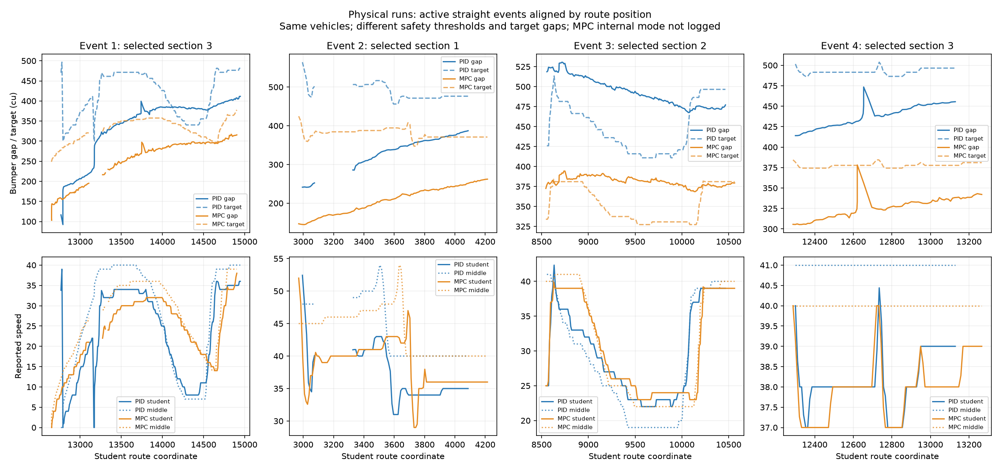

# Physical straight-event comparison: PID 2.8 vs MPC 2.8

Sources: `group4.zip` (corrected Group 4 PID run) and `experiment2_20261020_145126.zip` (identified by the user as MPC 2.8). Analysis date: 2026-10-20. Controller and experiment code remain unchanged.

## Main observations

- PID active gap min/median/max: 92.3 / 385.4 / 537.8.
- MPC active gap min/median/max: 103.2 / 293.9 / 400.5.
- Spacing-emergency flags during active control: PID 0; MPC 0.
- Sensor flags during active control: PID 2; MPC 0. MPC has 1 additional sensor flag outside its active-control intervals.

## Comparison limits that affect interpretation

- The corrected PID and MPC runs use the same vehicle identifiers for all three roles. The user also confirms the student vehicle did not physically change.
- TA emergency-spacing threshold changed from 80 (PID) to 50 (MPC). Report common gap bands rather than treating absence of native emergency flags as equivalent safety evidence. Logged student gaps stayed above 80 in both runs, so this spacing shield did not activate and the threshold difference does not directly explain the observed student-gap behavior.
- Launch gaps differ: student gap about 117 (PID) versus 103 (MPC); middle-to-leader gap also differs.
- PID target is 300 + 1.8*(2.8*v_reported); MPC target is 250 + 1.2*(2.8*v_reported). At reported speed 40 these are 501.6 and 384.4 coordinate units. A smaller MPC gap is partly intentional.
- Neither archive contains the deployed source/hash or MPC internal solver status. student_straight confirms execution of the callback, not optimizer success. The MPC file can return fallback commands without changing that wrapper mode. Results here describe the run labelled MPC, not a verified optimization-only run.
- One run per controller supports descriptive findings, not causal superiority claims.

## Event-based processing

As in Lab I, use per-straight events and a common 0.1 s grid with no extrapolation. Reject source spans above 0.3 s. Gate on logged student_straight and verified middle/student same selected section, rather than generic straight-road labels. The leader need not occupy that same straight. Match events by section and occurrence, not by whole-run elapsed time. Launch is event 1; event 4 is truncated by each run end.

Gap is forward route distance minus 250. Target uses aligned telemetry because that is the controller input. Speed-variation ratios below use aligned reported velocity; they are NOT position-derived physical acceleration or a string-stability proof. Ratios are withheld when middle reported-speed standard deviation is below 1 unit. Position-derived traces in the PID run have jumps, so a physical jerk/TTC ranking would require additional data-quality work.

## Full active events

| Event | Method | Section | Time window (s) | Gap entry → exit | Median gap | Own-target RMSE | Bias | Reported-speed SD ratio |
|---|---|---:|---|---|---:|---:|---:|---:|
| 1 | PID | 3 | 0.3-28.3 | 116.4 → 411.4 | 366.7 | 114.5 | -84.2 | 0.861 |
| 1 | MPC | 3 | 0.1-29.8 | 103.2 → 315.6 | 261.8 | 94.9 | -84.1 | 0.898 |
| 2 | PID | 1 | 59.1-69.2 | 241.4 → 387.2 | 347.8 | 157.3 | -147.6 | 0.866 |
| 2 | MPC | 1 | 61.1-72.4 | 146.9 → 262.2 | 213.8 | 175.2 | -170.2 | 1.010 |
| 3 | PID | 2 | 110.1-130.2 | 518.6 → 477.1 | 491.4 | 57.2 | 46.1 | 0.776 |
| 3 | MPC | 2 | 112.3-133.3 | 372.6 → 379.4 | 381.3 | 37.4 | 30.2 | 0.834 |
| 4 | PID | 3 | 145.7-153.3 | 414.0 → 455.5 | 439.1 | 55.6 | -54.0 | quiet input |
| 4 | MPC | 3 | 147.8-156.8 | 305.6 → 342.1 | 327.8 | 52.0 | -50.3 | quiet input |

Positive bias means gap above the method's own target; negative means below. The target and entry conditions differ, so own-target RMSE alone is not a fair overall ranking.

## Shared route coverage within corresponding active events

Restrict each run to the intersection of student route coordinates for each matched event. Use only actual retained aligned samples; no resampling across source-data holes. This controls route coverage, but not inherited state, sampling density or disturbances.

| Event | Shared route length | PID median gap | MPC median gap | PID own-target RMSE | MPC own-target RMSE |
|---|---:|---:|---:|---:|---:|
| 1 | 2138.3 | 366.1 | 280.0 | 115.1 | 83.0 |
| 2 | 1092.4 | 347.8 | 208.3 | 157.3 | 179.3 |
| 3 | 1908.8 | 491.4 | 381.6 | 57.2 | 38.3 |
| 4 | 829.2 | 439.1 | 326.4 | 55.6 | 52.8 |

## Interpretation

In event 3, MPC median gap is about 381 versus PID 491. The approximately 110-unit difference is close to the 117.2-unit difference between the two nominal targets at reported speed 40. This supports a target-policy explanation for much of the smaller MPC spacing, rather than treating it as proof of better control.

For the full event 3 window, MPC has lower own-target RMSE (37.4 versus 57.2), while PID has a lower reported-speed standard-deviation ratio (0.776 versus 0.834). In event 2, PID own-target RMSE is lower (157.3 versus 175.2), but its entry gap is also much closer to its target. These descriptive tradeoffs do not yield an unqualified winner.

Compare event 2 entry gaps before attributing recovery to a method: both controllers inherit the preceding bypass trajectory. Event 3 provides a longer braking/recovery comparison. Event 4 has little middle-speed excitation, so speed-variation ratios would be unstable and uninformative.

Do not interpret fewer native emergency flags as proof MPC is safer: the safety threshold and sensor conditions differ. Do not infer computation latency from the command dt column: that measures loop cadence, not callback duration.

Machine-readable event metrics and aligned event CSVs are in `results/pid_vs_mpc_2p8/`.
