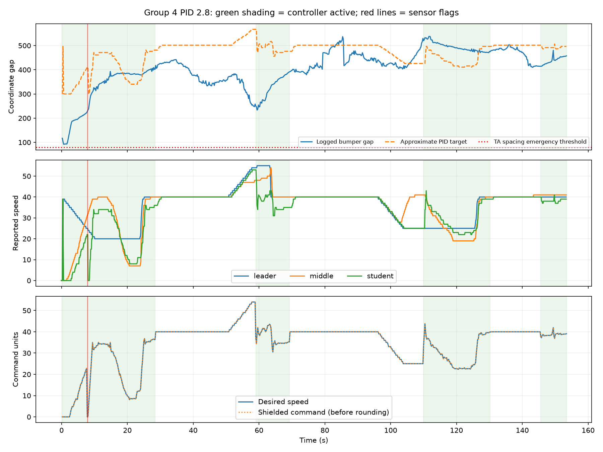

# Group 4: corrected PID 2.8 physical run

Source: `group4.zip`, received 2026-10-20. User identifies this as the corrected Group 4 PID 2.8 run. The archive does not embed a controller source hash. No controller or experiment code was revised.

## Main findings

- Duration: 153.42 s; 768 student command decisions.
- Active PID: 337 decisions (43.9%); remaining decisions use the TA leader-speed bypass.
- Logged bumper gap: minimum 92.31, median 415.28, maximum 537.82 coordinate units.
- Spacing emergency triggers: 0. Center-sensor emergency samples: 2.
- Median actual control interval: 0.200 s, despite 0.15 s configured period.

The constant-0.09 active-command failure from the earlier Group 1 deployment is absent. This run has changing desired-speed commands, repeated active control, and a bounded gap rather than progressive separation to thousands of units.

## Gap target

The saved PID 2.8 design requests gap = 300 + 1.8 * (2.8 * reported speed). At reported speeds 20, 25 and 40, this is approximately 401, 426 and 502 coordinate units. A gap around 400-500 is therefore not automatically excessive for this particular design. The target itself is intentionally conservative.

Using latest logged telemetry to approximate the callback state, active target RMSE is 109.20 and mean signed error is -53.54 coordinate units. These are approximate because exact callback input snapshots and callback-entry timestamps are unavailable. The first active episode includes launch; do not interpret its transient error as steady-state tracking performance.

| Active episode (s) | Samples | Minimum gap | Median gap | Maximum gap | Approx. target RMSE |
|---|---:|---:|---:|---:|---:|
| 0.23-28.41 | 143 | 92.3 | 362.7 | 409.3 | 115.6 |
| 59.02-69.22 | 52 | 233.4 | 339.0 | 391.0 | 177.2 |
| 110.02-130.21 | 102 | 466.8 | 490.4 | 537.8 | 58.6 |
| 145.62-153.42 | 40 | 414.6 | 439.9 | 480.5 | 55.3 |

## Safety and interpretation

Two consecutive center-sensor emergency samples occur at approximately 7.82 and 8.02 s with route bumper gaps 227.2 and 233.0. These are sensor-triggered events, not logged spacing-threshold violations. Route gap alone cannot establish whether the sensor observed a real obstacle or a transient. Desired command is already zero on those rows, so the records do not show a positive PID command being overridden on those particular samples.

Minimum logged gap 92.3 exceeds the TA emergency threshold of 80 but is below the controller's 120-unit protective threshold. This occurs in the launch episode; the GUI issues initial start commands before subsequent closed-loop updates. The log alone cannot prove a physical collision did or did not occur.

This is one physical run, with PID active less than half the time. It supports a successful execution observation and a bounded-gap result, not a method ranking or a proof of string stability. Disturbance propagation should be compared per matched event with the second controller once its data is available.

The earlier archive `experiment2_20261020_135916.zip` is a deployment-error diagnostic run using Group 1's controller, per the user's confirmation. It is not a controlled baseline for evaluating Group 4 PID performance.

