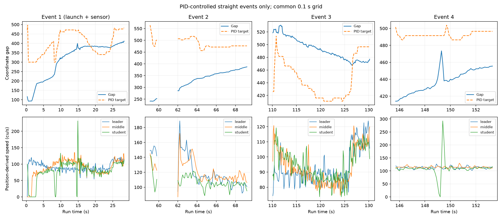

# Group 4 PID 2.8: straight-event analysis

This is the primary controller-performance view. Whole-run plots remain useful for context, but curve/noncontrol samples are not scored as PID behavior.

## Processing, following Lab I

- Reviewed Lab I preprocess_stage2.py, preprocess_stage3.py, preprocess_stage4.py, and analysis/metrics.py.
- Identify events from consecutive student_straight command decisions. A generic zone_type=straight tag is insufficient: middle and student must share one of the three selected control straights.
- Use a common 0.1 s grid, no extrapolation; discard points with source interpolation spans over 0.3 s. Align all three vehicles, but require only middle/student same-section membership for PID eligibility.
- Derive measured speeds from aligned x/y using central chord differences, one-sided at ends, as in Lab I. Split data holes before differentiation. No extra 2.8 multiplication is applied to position-derived speeds.
- Keep route bumper spacing (forward route distance minus 250), matching Lab II command logging. Lab I used heading projection; these definitions are not silently interchanged.
- Reconstruct the controller target from reported student velocity using 300 + 1.8*2.8*v. This is a controller-internal reference, distinct from position-derived speed used for observed motion.
- Retain genuine within-event stops and identify sensor intervention separately. Event 1 includes launch and sensor stopping, so report it separately from later events. No arbitrary transient cutoff is chosen to improve the scores.
- TTC = gap / (student speed - middle speed) during closing only. Do not copy the reversed closing-speed sign stated in the Lab I metrics module docstring.

| Event | Section | Common interval (s) | Points | Gap min/median/max | Target RMSE | Target bias |
|---|---:|---|---:|---|---:|---:|
| 1 | 3 | 0.3-28.3 | 281 | 92.3 / 366.7 / 411.4 | 114.5 | -84.2 |
| 2 | 1 | 59.1-69.2 | 81 | 241.3 / 347.8 / 387.2 | 157.3 | -147.6 |
| 3 | 2 | 110.1-130.2 | 202 | 467.5 / 491.4 / 530.6 | 57.2 | 46.1 |
| 4 | 3 | 145.7-153.3 | 77 | 414.0 / 439.1 / 473.5 | 55.6 | -54.0 |

Later events (2-4), pooled by retained sample: target RMSE 89.82 coordinate units. This excludes the launch event explicitly, but still includes section-entry transients.

Event 2 begins with an inherited short gap. Its larger error belongs in the report, while the preceding noncontrol segment is context rather than PID-controlled operation. Events 3 and 4 should be discussed individually; do not turn a whole-run gap median into a PID tracking metric.

Position-derived speed variation and TTC are saved in JSON as descriptive diagnostics. Sharp position-derived student-speed spikes occur in events 1 and 4, while reported-speed traces are much smoother. These may reflect position/timing artifacts and require sample-level review before any acceleration, jerk, TTC or disturbance-amplification claim. No outliers were silently removed. Localization quantization affects derivatives; they do not prove string stability. No whole-run acceleration/jerk ranking is inferred. Event 4 is truncated by run end.

